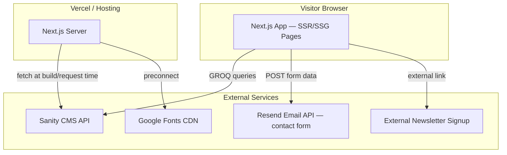
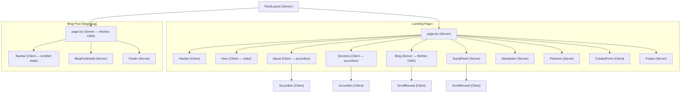

# Design Document — Keanu Le Roux Financial Advisor Website

## Overview

This design describes the production implementation of the Keanu Le Roux Financial Advisor website — a responsive, single-page landing site with a standalone blog post detail page. The site is built with Next.js (App Router) and TypeScript, using Sanity CMS exclusively for blog post management. All other content is static.

The prototype in `prototype/` is the visual source of truth. The production build faithfully reproduces its layout, styling, and interactions while introducing proper component architecture, CMS integration, type safety, and the bug fixes tracked in `quality-assurance/bugs.csv`.

### Key Design Decisions

| Decision | Rationale |
|---|---|
| Next.js App Router | Server-side rendering for SEO, file-based routing, React Server Components for CMS data fetching |
| CSS Modules + CSS custom properties | Matches the prototype's vanilla CSS approach; design tokens via custom properties on `:root`; component-scoped styles via CSS Modules avoid class collisions |
| Sanity CMS (blog only) | Headless CMS with GROQ queries, rich text via Portable Text, built-in auth — minimal scope keeps complexity low |
| Static content in code | Services, social links, partner logos, and all non-blog text live in TypeScript data files — no CMS overhead for rarely-changing content |
| Resend for email delivery | Contact form submissions are sent via the Resend email API (`resend` npm package). Resend API key stored in `.env.local` as `RESEND_API_KEY` (BUG-051) |
| Client Components only where needed | Navbar scroll behaviour, accordion, contact form, scroll reveal, and mobile nav toggle require client-side JS; all other components are Server Components |

---

## Architecture

### High-Level Architecture



### Rendering Strategy

| Route | Strategy | Reason |
|---|---|---|
| `/` (landing page) | ISR (revalidate: 60s) | Blog data from Sanity needs periodic refresh; static sections benefit from caching |
| `/blog/[slug]` | ISR (revalidate: 60s) | Individual blog posts update when Admin_User publishes; ISR balances freshness and performance |

### Design Tokens

The following CSS custom properties SHALL be defined on `:root` in `globals.css`. All component styles MUST reference these tokens rather than hardcoding colour, font, or layout values (BUG-047).

```css
:root {
  --navy: #1a2456;
  --navy-dark: #111b42;
  --navy-light: #2a3570;
  --steel-blue: #7a9bb5;
  --steel-blue-hover: #6889a3;
  --accent: #5a70a0;
  --white: #ffffff;
  --off-white: #f9f9f9;
  --gray-100: #f5f5f5;
  --gray-200: #e0e0e0;
  --gray-400: #999;
  --gray-600: #666;
  --text-dark: #1a2456;
  --text-body: #444;
  --success: #4ade80;
  --font-heading: 'Playfair Display', Georgia, serif;
  --font-body: 'Inter', -apple-system, sans-serif;
  --max-width: 1100px;
  --transition: 0.3s ease;
}
```

### Section Spacing

Each section component MUST apply the vertical padding and background colour specified below. These values match the screen requirements and ensure consistent visual rhythm across the page (BUG-049).

| Component | Vertical Padding | Background |
|---|---|---|
| Hero | 100vh (full viewport) | Video + navy overlay |
| About | 100px | White (#ffffff) |
| Services | 100px | White (#ffffff) |
| Blog | 100px | Off-white (#f9f9f9) |
| Social Feed | 100px | White (#ffffff) |
| Newsletter | 80px | Navy (#1a2456) |
| Partners | 80px | White (#ffffff) |
| Contact | 100px | Off-white (#f9f9f9) |
| Footer | 60px top | White (#ffffff) |

### Project File Structure

```
/
├── public/
│   ├── favicon.svg
│   ├── hero_video.mp4
│   ├── hero-fallback.jpg          # Fallback image for hero (Req 2 AC 5, BUG-029)
│   ├── keanu.jpg
│   └── images/
│       ├── services/              # 3 service landscape images
│       └── partners/              # 5 partner logo images
│
├── src/
│   ├── app/
│   │   ├── layout.tsx             # Root layout: fonts (font-display: swap for Google Fonts), favicon (<link rel="icon" type="image/svg+xml" href="/favicon.svg">), metadata, global CSS
│   │   ├── page.tsx               # Landing page (all sections composed)
│   │   ├── not-found.tsx          # Custom 404 page (BUG-045)
│   │   ├── globals.css            # Design tokens, reset, shared styles
│   │   ├── api/
│   │   │   └── contact/
│   │   │       └── route.ts       # Contact form API route (POST handler)
│   │   └── blog/
│   │       └── [slug]/
│   │           └── page.tsx       # Blog post detail page
│   │
│   ├── components/
│   │   ├── Navbar.tsx             # Fixed navbar with scroll + mobile toggle
│   │   ├── Navbar.module.css
│   │   ├── Hero.tsx               # Video hero with CTAs
│   │   ├── Hero.module.css
│   │   ├── About.tsx              # Portrait + bio + accordion
│   │   ├── About.module.css
│   │   ├── Services.tsx           # Images + service accordion
│   │   ├── Services.module.css
│   │   ├── Blog.tsx               # Featured post + card grid
│   │   ├── Blog.module.css
│   │   ├── SocialFeed.tsx         # YouTube/LinkedIn/Instagram cards
│   │   ├── SocialFeed.module.css
│   │   ├── Newsletter.tsx         # Navy CTA with subscribe link
│   │   ├── Newsletter.module.css
│   │   ├── Partners.tsx           # Logo row
│   │   ├── Partners.module.css
│   │   ├── ContactForm.tsx        # Form with validation + success state
│   │   ├── ContactForm.module.css
│   │   ├── Footer.tsx             # Footer with social + contact info
│   │   ├── Footer.module.css
│   │   ├── Accordion.tsx          # Reusable accordion (used by About + Services)
│   │   ├── Accordion.module.css
│   │   ├── ScrollReveal.tsx       # IntersectionObserver wrapper
│   │   ├── BlogPostDetail.tsx     # Blog post detail content layout
│   │   └── BlogPostDetail.module.css
│   │
│   ├── lib/
│   │   ├── sanity.ts              # Sanity client config + GROQ queries
│   │   └── types.ts               # Shared TypeScript types
│   │
│   └── data/
│       ├── services.ts            # 7 service items (title + description)
│       ├── socialLinks.ts         # YouTube, LinkedIn, Instagram URLs + metadata
│       └── siteConfig.ts          # Contact info, nav links, partner data
│
├── sanity/
│   ├── sanity.config.ts           # Sanity Studio config
│   ├── sanity.cli.ts              # Sanity CLI config
│   └── schemas/
│       └── blogPost.ts            # Blog post schema (date, title, slug, excerpt, image, body)
│
├── next.config.ts
├── tsconfig.json
├── package.json
└── .env.local                     # SANITY_PROJECT_ID, SANITY_DATASET, SANITY_API_TOKEN, RESEND_API_KEY
```

---

## Components and Interfaces

### Component Tree



> **Server/Client Component rendering note:** Server Components can render Client Components as children. For example, the Blog (Server) component renders ScrollReveal (Client) wrappers around blog cards. This is a standard Next.js App Router pattern.

### Component Specifications

#### Section ID Attribute Mapping

Each section component MUST render an `id` attribute on its outermost `<section>` element. These IDs are the anchor targets for the Navbar links and must match exactly for anchor navigation to work (Req 1 AC 5).

| Component | Section `id` |
|---|---|
| Hero | `hero` |
| About | `about` |
| Services | `services` |
| Blog | `blog` |
| Newsletter | `newsletter` |
| Contact | `contact` |

> **Note:** On the landing page, Navbar links use `<a href="#hero">`, `<a href="#about">`, etc. On the blog post detail page, Navbar links use `<a href="/#hero">`, `<a href="/#about">`, etc. If a section `id` does not match the corresponding Navbar `href` anchor, smooth-scroll navigation will silently fail.

#### Root Layout (`layout.tsx`)

- Server Component — wraps all pages
- Loads Google Fonts (Playfair Display + Inter) with `font-display: swap` to ensure text is visible immediately with system fonts while web fonts load
- Includes favicon metadata: `<link rel="icon" type="image/svg+xml" href="/favicon.svg">`
- Imports `globals.css` for design tokens, reset, and shared styles
- Wraps page content in `<main>` landmark (BUG-007/033)
- Sets site-wide `<html lang="en">` and `<meta>` tags

#### Navbar

```typescript
// Client Component — handles scroll state + mobile toggle
interface NavbarProps {
  alwaysScrolled?: boolean; // true on blog post page (Req 19 AC 2)
}
```

- Listens to `window.scroll` to toggle transparent ↔ scrolled state (threshold: 50px) with a 0.3-second ease transition for the background, text colour, and box shadow changes (Req 12 AC 4)
- Mobile: hamburger toggle shows/hides dropdown; links auto-close dropdown on click
- The hamburger toggle button SHALL include `aria-label="Toggle navigation menu"` (Req 13 AC 3, BUG-050)
- Nav link text over the hero section SHALL use full white (#ffffff or rgba(255,255,255,1)), not semi-transparent white. The prototype used rgba(255,255,255,0.85) which is incorrect (BUG-018)
- All links use `<a href="#section">` on landing page, `<a href="/#section">` on blog page (Next.js App Router convention — the prototype uses `index.html` but production uses `/`)
- Fixes: BUG-007/033 — wraps page content in `<main>` landmark (handled in layout)
- Fixes: BUG-008/019 — adds visible `:focus-visible` outlines on all interactive elements

#### Hero

```typescript
// Client Component — video element needs client hydration
interface HeroProps {}
```

- `<video autoPlay muted loop playsInline>` with `<source src="/hero_video.mp4">`
- Navy overlay `rgba(20, 28, 66, 0.55)` via absolute-positioned div
- Fallback: `poster` attribute on video pointing to `/hero-fallback.jpg` (BUG-029/035)
- The `<video>` element SHALL include `aria-label="Background video showing professional financial advisory imagery"` for screen reader accessibility (Req 13 AC 3, BUG-041)
- If video fails to load, the poster image + navy-dark background remain visible
- Two CTA buttons: "Get In Touch" → `#contact`, "Subscribe to Newsletter" → `#newsletter`

#### About

```typescript
// Client Component — contains Accordion which requires client-side state
interface AboutProps {}
```

- Two-column layout on desktop: 320px portrait (left) + text column (right), 60px gap, vertically centred
- Heading: "Financial Guidance You Can Trust." (Playfair Display, 2.4rem)
- Two paragraphs summarising Keanu's background, qualifications, and philosophy
- Below portrait row: Accordion with three expandable items (only one open at a time):
  - "My approach" (open by default)
  - "Qualifications & experience"
  - "Why work with me"
- Each accordion item: Header row with label + "+" icon; icon rotates 45° when active; body reveals paragraph content with smooth max-height transition
- Displays a centred "Get Started" pill button below the Accordion that smooth-scrolls to the Contact_Form section (`#contact`) when clicked (Req 3 AC 8)
- Tablet/mobile (≤900px): Portrait stacks above text, centred at max 320px width
- **References:** Req 3 AC 1–9

#### Accordion

```typescript
// Client Component — manages expand/collapse state
interface AccordionItem {
  title: string;
  content: React.ReactNode;
}

interface AccordionProps {
  items: AccordionItem[];
  defaultOpenIndex?: number; // defaults to 0
}
```

- Only one item open at a time per accordion instance
- `aria-expanded` on header buttons reflects state (Req 13 AC 4)
- "+" icon rotates 45° to "×" when active
- `max-height` transition 0.4s ease
- Fixes: BUG-008 — adds `:focus-visible` outline on accordion headers

#### Blog (Landing Page Section)

```typescript
// Server Component — fetches blog posts from Sanity at render time
interface BlogSectionProps {
  posts: BlogPost[]; // passed from page.tsx after Sanity fetch
}
```

- Featured post = most recent published post (Req 5 AC 8)
- Featured article layout: two-column layout (image left, content right) that stacks to single column on tablet/mobile (Req 5 AC 2, AC 3):
  - Image area: 340px tall, grey background placeholder (or post mainImage)
  - Content column: date label (uppercase, small, grey), article title in Playfair Display at 1.8rem, excerpt paragraph, and a "Read Full Article →" link
- Remaining posts displayed in a 2-column card grid
- If no posts exist, displays a placeholder/default post (Req 5 AC 9)
- If a blog post has no mainImage, the blog card and featured article SHALL display a default placeholder image rather than a broken image or empty space
- Cards wrapped in `<ScrollReveal>` for fade-in animation
- Cards link to `/blog/[slug]`
- Blog cards lift 3px vertically on hover with a subtle box shadow (Req 5 AC 6, Req 12 AC 2)

#### ContactForm

```typescript
// Client Component — form state, validation, submission
interface ContactFormProps {}
```

- Fields: firstName (required), lastName (required), email (required), phone (optional), message (required)
- Bottom-border-only input styling
- Native HTML5 validation via `required` attribute (Req 9 AC 7)
- On successful submit: hides form, shows success confirmation with green checkmark
- Submits to a server-side API route (`/api/contact`) that forwards to email via Resend (BUG-051)
- If the server-side submission fails, the form displays an inline error message: "Something went wrong. Please try again later." styled in red/error colour below the submit button. The form remains visible so the user can retry.
- Fixes: BUG-006 — implements actual backend email integration
- Fixes: BUG-025 — adds honeypot field + rate limiting for spam protection

#### ScrollReveal

```typescript
// Client Component — IntersectionObserver wrapper
interface ScrollRevealProps {
  children: React.ReactNode;
  className?: string;
}
```

- Uses `IntersectionObserver` with `threshold: 0.1` and `rootMargin: '0px 0px -40px 0px'`
- Applies `opacity: 0 → 1` and `translateY(20px) → 0` with a 0.6-second ease transition for opacity and transform (matching the prototype's 0.6s timing)
- Fixes: BUG-001 — targets correct elements (blog cards + feed cards)

#### Newsletter

```typescript
// Server Component — static content, no client-side JS needed
interface NewsletterProps {}
```

- Displays a navy (#1a2456) background section with centred content (max 560px)
- Heading: "Stay Ahead of the Curve" in italic serif white text
- Description paragraph explaining subscriber value in light white text (opacity 0.7)
- Benefit list: three inline items with checkmark (✓) prefixes, flex-wrap layout
  - "Practical wealth-building strategies"
  - "Market updates and economic insights"
  - "Tips for smarter financial decisions"
- "Subscribe" pill button with white outlined style — renders as an `<a>` element with `target="_blank"` and `rel="noopener noreferrer"` linking to the external newsletter signup page
- No email input field, no inline form — the button is a direct external link only
- **References:** Req 7 AC 1–7

#### Partners

```typescript
// Server Component — static content, no client-side JS needed
interface PartnersProps {}
```

- Displays a white background section with 80px vertical padding and a 1px solid grey top border
- Heading: "Trusted Partners" with a subtitle paragraph, centred
- Horizontally centred flex row of 5 static partner logo images, each 160×70px
- Flex layout with `flex-wrap`, 48px gap above 768px viewport width, 24px gap at or below 768px (BUG-046)
- Partner logos reduce opacity slightly on hover
- Partner logos are static images maintained in the codebase (not CMS-managed)
- **References:** Req 8 AC 1–6

#### SocialFeed

```typescript
// Server Component — static content with external links
interface SocialFeedProps {}
```

- Displays the centred heading "Latest Content" with a subtitle paragraph on a white background
- Three-column grid of clickable feed cards on desktop (single column on mobile): YouTube, LinkedIn, Instagram
- Each card is a full `<a>` element with `target="_blank"` and `rel="noopener noreferrer"` linking to the corresponding platform URL
- Badge row on each card: platform icon + platform name text + right-aligned external link icon (grey → navy on hover)
- Platform-specific preview areas:
  - YouTube: grey preview area with centred play button overlay (dark semi-transparent circle)
  - LinkedIn: italic serif quote on grey background (min-height 200px)
  - Instagram: gradient preview area (gold → pink → purple) using `background` with `rgba()` colour values (NOT element-level opacity) to avoid BUG-010 transparency bleed
- Info area on each card: title, description, and platform-specific CTA text (e.g. "Watch on YouTube →")
- Feed cards lift 3px vertically on hover with a box shadow, and the external link icon and CTA text change colour (Req 6 AC 8, Req 12 AC 2)
- Cards wrapped in `<ScrollReveal>` for fade-in animation
- **References:** Req 6 AC 1–9

#### Footer

```typescript
// Server Component — static content
interface FooterProps {}
```

- Displays a white background with a 1px solid grey top border and 60px top padding
- All content centred:
  - Logo text: "KEANU LE ROUX" (uppercase, letter-spaced, navy, Inter font)
  - Tagline: "Financial Advisor" (italic serif, grey)
  - Social icon row: YouTube, Instagram, LinkedIn — navy colour, transition to accent blue on hover. Each icon is an `<a>` with `target="_blank"`, `rel="noopener noreferrer"`, and `aria-label`
  - Email link: `mailto:` link in italic serif, underlined with 4px text-underline-offset (all-lowercase display is acceptable; branded mixed-case from the prototype is not required — BUG-046)
  - Details block (small grey text, 0.8rem): phone number, "An Authorised Financial Services Representative", copyright line
- **References:** Req 10 AC 1–5

#### BlogPostDetail

```typescript
// Server Component — receives post data from page.tsx
interface BlogPostDetailProps {
  post: BlogPost;
}
```

- Renders: back link, date, h1 title, excerpt, full-width image, Portable Text body, CTA block, author bio
- Body supports: paragraphs, `<h2>` subheadings, `<ul>` lists (via Portable Text serializers)
- CTA: "Get In Touch" pill button → `/#contact`
- Author bio: circular portrait, name, title

---

## Data Models

### Sanity CMS Schema — Blog Post

```typescript
// sanity/schemas/blogPost.ts
export default {
  name: 'blogPost',
  title: 'Blog Post',
  type: 'document',
  fields: [
    {
      name: 'title',
      title: 'Title',
      type: 'string',
      validation: (Rule: any) => Rule.required(),
    },
    {
      name: 'slug',
      title: 'Slug',
      type: 'slug',
      options: { source: 'title', maxLength: 96 },
      validation: (Rule: any) => Rule.required(),
    },
    {
      name: 'publishedAt',
      title: 'Published Date',
      type: 'datetime',
      validation: (Rule: any) => Rule.required(),
    },
    {
      name: 'excerpt',
      title: 'Excerpt',
      type: 'text',
      rows: 3,
      validation: (Rule: any) => Rule.required().max(300),
    },
    {
      name: 'mainImage',
      title: 'Main Image',
      type: 'image',
      options: { hotspot: true },
      fields: [
        {
          name: 'alt',
          title: 'Alt Text',
          type: 'string',
          validation: (Rule: any) => Rule.required(),
        },
      ],
    },
    {
      name: 'body',
      title: 'Body',
      type: 'array',
      validation: (Rule: any) => Rule.required(),
      of: [
        {
          type: 'block',
          styles: [
            { title: 'Normal', value: 'normal' },
            { title: 'H2', value: 'h2' },
          ],
          lists: [{ title: 'Bullet', value: 'bullet' }],
          marks: {
            decorators: [
              { title: 'Bold', value: 'strong' },
              { title: 'Italic', value: 'em' },
            ],
          },
        },
        {
          type: 'image',
          options: { hotspot: true },
          fields: [
            {
              name: 'alt',
              title: 'Alt Text',
              type: 'string',
            },
          ],
        },
      ],
    },
    {
      name: 'published',
      title: 'Published',
      type: 'boolean',
      initialValue: false,
    },
  ],
  orderings: [
    {
      title: 'Published Date, New',
      name: 'publishedAtDesc',
      by: [{ field: 'publishedAt', direction: 'desc' }],
    },
  ],
  preview: {
    select: {
      title: 'title',
      media: 'mainImage',
      date: 'publishedAt',
    },
  },
};
```

### TypeScript Types

```typescript
// src/lib/types.ts

export interface BlogPost {
  _id: string;
  title: string;
  slug: { current: string };
  publishedAt: string;       // ISO 8601 datetime
  excerpt: string;
  mainImage?: {
    asset: { url: string };
    alt: string;
  };
  body: PortableTextBlock[];  // Sanity Portable Text
  published: boolean;
}

export interface ServiceItem {
  title: string;
  description: string;
}

export interface SocialLink {
  platform: 'youtube' | 'linkedin' | 'instagram';
  url: string;
  title: string;
  description: string;
  ctaText: string;           // e.g. "Watch on YouTube →"
}

export interface NavLink {
  label: string;
  href: string;
}

export interface PartnerLogo {
  name: string;
  src: string;               // path in /public/images/partners/
  alt: string;
}

export interface ContactFormData {
  firstName: string;
  lastName: string;
  email: string;
  phone?: string;
  message: string;
  honeypot?: string;         // Hidden field for spam protection (BUG-025, BUG-039)
}
```

### GROQ Queries

```typescript
// src/lib/sanity.ts
import { createClient } from '@sanity/client';

export const sanityClient = createClient({
  projectId: process.env.SANITY_PROJECT_ID!,
  dataset: process.env.SANITY_DATASET || 'production',
  apiVersion: '2024-01-01',
  useCdn: true,
});

// Fetch all published posts, newest first (landing page)
export const allPublishedPostsQuery = `
  *[_type == "blogPost" && published == true] | order(publishedAt desc) {
    _id, title, slug, publishedAt, excerpt,
    mainImage { asset->{ url }, alt }
  }
`;

// Fetch single post by slug (blog detail page)
export const postBySlugQuery = `
  *[_type == "blogPost" && slug.current == $slug && published == true][0] {
    _id, title, slug, publishedAt, excerpt, body,
    mainImage { asset->{ url }, alt }
  }
`;

// Fetch all published slugs (for generateStaticParams)
export const allPostSlugsQuery = `
  *[_type == "blogPost" && published == true] { slug }
`;
```

### Static Data Files

```typescript
// src/data/services.ts
export const services: ServiceItem[] = [
  { title: 'Integrated Wealth Planning', description: '...' },
  { title: 'Risk Protection', description: '...' },
  { title: 'Healthcare Planning', description: '...' },
  { title: 'Investments & Savings', description: '...' },
  { title: 'Retirement Planning', description: '...' },
  { title: 'Business Planning', description: '...' },
  { title: 'Estate Planning', description: '...' },
];

// src/data/socialLinks.ts
export const socialLinks: SocialLink[] = [
  {
    platform: 'youtube',
    url: 'https://www.youtube.com/channel/UCx1K9NdhRghMU_TWBDNCC6g',
    title: 'How to Build Wealth in Your 20s',
    description: '...',
    ctaText: 'Watch on YouTube →',
  },
  // ... linkedin, instagram
];
```

### Contact Form API Route

```typescript
// src/app/api/contact/route.ts
import { NextRequest, NextResponse } from 'next/server';

export async function POST(req: NextRequest) {
  const data: ContactFormData = await req.json();

  // Honeypot check (BUG-025)
  if (data.honeypot) {
    return NextResponse.json({ success: true }); // silently reject bots
  }

  // Rate limiting (basic: per-IP, in-memory or via middleware)
  // Validate required fields server-side
  // Send email via Resend
  // Return success/error response
}
```


---

## Correctness Properties

*A property is a characteristic or behavior that should hold true across all valid executions of a system — essentially, a formal statement about what the system should do. Properties serve as the bridge between human-readable specifications and machine-verifiable correctness guarantees.*

### Property 1: Accordion mutual exclusion

*For any* accordion component with N items, after clicking item X, item X should be expanded and all other N-1 items should be collapsed. This must hold regardless of which item was previously open.

**Validates: Requirements 3.6, 4.5**

### Property 2: Blog card rendering completeness

*For any* blog post returned by the CMS, the rendered blog card should contain an image element (either the post's mainImage or a default placeholder image), a date label, a title, an excerpt, and a "Read More" link. No required element may be missing.

**Validates: Requirements 5.5**

### Property 3: Most recent published post is featured

*For any* set of published blog posts with distinct `publishedAt` dates, the featured article displayed in the Blog section should be the post with the most recent `publishedAt` value.

**Validates: Requirements 5.8, 15.5**

### Property 4: Feed card external link safety and structure

*For any* social feed card, the wrapping `<a>` element should have `target="_blank"` and `rel="noopener noreferrer"` attributes, and the card should contain a badge row with the platform icon, platform name, and an external link icon.

**Validates: Requirements 6.7, 6.9**

### Property 5: Contact form validation rejects incomplete submissions

*For any* contact form submission where at least one required field (firstName, lastName, email, message) is empty or whitespace-only, the form should prevent submission and the form state should remain unchanged (no success message shown).

**Validates: Requirements 9.7**

### Property 6: Pill-shaped button styling

*For any* general button element on the site (excluding hero CTAs and submit button which have their own variants), the button should have `border-radius: 40px`, a navy border, and transparent background in its default state.

**Validates: Requirements 11.7**

### Property 7: All images have alt attributes

*For any* `` element rendered on any page of the site, the element should have a non-empty `alt` attribute.

**Validates: Requirements 13.2**

### Property 8: Icon-only interactive elements have aria-label

*For any* interactive element (button or anchor) that contains only an SVG icon and no visible text content, the element should have a non-empty `aria-label` attribute.

**Validates: Requirements 13.3**

### Property 9: Accordion aria-expanded reflects state

*For any* accordion header button, the `aria-expanded` attribute value should be `"true"` when its content panel is visible and `"false"` when its content panel is collapsed. This must hold after any sequence of user interactions.

**Validates: Requirements 13.4**

### Property 10: Color contrast meets readable standards

*For any* text element on the site, the contrast ratio between the text color and its background color should meet WCAG AA minimum (4.5:1 for normal text, 3:1 for large text ≥18pt or bold ≥14pt).

**Validates: Requirements 13.6**

### Property 11: Form inputs have associated labels

*For any* input or textarea element in the contact form, there should exist a `<label>` element whose `for` attribute matches the input's `id` attribute.

**Validates: Requirements 13.7**

### Property 12: Scripts use non-blocking loading

*For any* external `<script>` tag in the rendered HTML, the tag should have either a `defer` or `async` attribute to prevent blocking initial content rendering.

**Validates: Requirements 14.4**

### Property 13: Below-fold images use lazy loading

*For any* `` element that is not within the Hero section or Navbar, the element should have the `loading="lazy"` attribute.

**Validates: Requirements 14.5**

### Property 14: Blog post data contains all required fields

*For any* blog post document in Sanity CMS, the document should contain non-null values for: title, slug, publishedAt, excerpt, and body. The mainImage field should have an alt text value when present.

**Validates: Requirements 5.7, 15.2**

### Property 15: Blog post edit round-trip

*For any* blog post, editing a field (title, excerpt, or body) in Sanity CMS and then fetching the post by slug should return the updated field value.

**Validates: Requirements 15.3**

### Property 16: Publish/unpublish toggle affects query visibility

*For any* blog post, setting `published` to `false` should exclude it from the published posts query results, and setting `published` to `true` should include it. The toggle is idempotent — setting the same value twice produces the same query result.

**Validates: Requirements 15.4**

### Property 17: Blog post detail page renders all CMS fields

*For any* published blog post in Sanity CMS, navigating to `/blog/[slug]` should render a page containing the post's title in an `<h1>`, the formatted publishedAt date, the excerpt as lead text, the main image (if present), and the full body content.

**Validates: Requirements 19.4, 19.12**

### Property 18: Newsletter subscribe button opens in new tab

*For any* rendered Newsletter section, the "Subscribe" button element should be an `<a>` element with `target="_blank"` and `rel="noopener noreferrer"` attributes, and should have a non-empty `href` pointing to an external URL.

**Validates: Requirements 7.6**

### Property 19: Navbar scroll state transition

*For any* scroll position greater than 50 pixels, the Navbar should display a white background with navy text. *For any* scroll position at or below 50 pixels, the Navbar should display a transparent background with white text. This must hold after any sequence of scroll events.

**Validates: Requirements 1.2, 1.3, 12.4**

---

## Error Handling

### Hero Video Failure

- The `<video>` element uses a `poster` attribute pointing to `/hero-fallback.jpg`
- The hero section has `background-color: var(--navy-dark)` as the base layer
- Degradation chain: video → poster image → navy-dark background color
- No JavaScript error handling needed — the browser handles video failure natively

### Sanity CMS Fetch Failures

- Blog section: If the Sanity query fails or returns an error, the Blog section renders a placeholder/default post (Req 5 AC 9) rather than crashing
- Blog post detail page: If the post is not found (invalid slug or unpublished), Next.js returns a 404 page via `notFound()` from `next/navigation`
- ISR revalidation: If revalidation fails, Next.js serves the previously cached version — the site never goes down due to a CMS outage

### Contact Form Errors

- Client-side: Native HTML5 validation prevents submission of empty required fields; email field validates format via `type="email"`
- Server-side (`/api/contact`): Validates all required fields are present and non-empty; validates email format; returns 400 with error message on validation failure
- Honeypot field: If filled (by bots), the API returns 200 silently without processing — no error exposed
- Rate limiting: Excessive submissions from the same IP return 429 Too Many Requests
- Email service failure: If Resend fails, the API returns 500 with a generic error message; the client displays "Something went wrong. Please try again later." instead of the success state

### 404 Page (BUG-045)

When a visitor navigates to an invalid URL (e.g. a non-existent blog slug or any unmatched route), the site SHALL display a custom 404 page with the following specification:

- **Navbar:** Rendered in scrolled state (white background, navy text, box shadow) — same as the blog post detail page (Req 19 AC 2)
- **Content (centred):**
  - Heading: "Page Not Found" (Playfair Display)
  - Message paragraph: "The page you're looking for doesn't exist or has been moved."
  - "Back to Home" pill button (`.btn` class) linking to `/`
- **Footer:** Standard Footer component (same as all other pages)
- **Responsive:** Follows the same breakpoints as the rest of the site

This page is implemented as `src/app/not-found.tsx` in the Next.js App Router convention. The `notFound()` call from blog post detail pages (invalid slugs) triggers this page automatically.

### Network and Loading States

- Google Fonts: `font-display: swap` ensures text is visible immediately with system fonts, swapping to web fonts when loaded
- Images: `loading="lazy"` on below-fold images prevents blocking; broken image links show alt text
- Sanity images: Use Sanity's image URL builder with width/quality parameters for optimized delivery

---

## Testing Strategy

### Dual Testing Approach

This project uses both unit/integration tests and property-based tests for comprehensive coverage.

- **Unit/integration tests** verify specific examples, edge cases, UI interactions, and component rendering
- **Property-based tests** verify universal properties that must hold across all valid inputs

### Test Framework

- **Test runner:** Vitest (fast, TypeScript-native, compatible with Next.js)
- **Component testing:** React Testing Library (`@testing-library/react`)
- **Property-based testing:** `fast-check` (JavaScript/TypeScript PBT library)
- **E2E testing (optional):** Playwright for critical user flows (navbar scroll, form submission, blog navigation)

### Property-Based Testing Configuration

- Each property test runs a minimum of **100 iterations**
- Each property test is tagged with a comment referencing its design property:
  ```
  // Feature: keanu-financial-advisor-website, Property 1: Accordion mutual exclusion
  ```
- Each correctness property is implemented by a **single** property-based test
- `fast-check` arbitraries generate random accordion indices, blog post data, form field combinations, etc.

### Unit Test Focus Areas

- **Navbar:** Scroll threshold state change (example at 0px, 51px); mobile toggle open/close; link click closes dropdown
- **Hero:** Video element attributes (autoplay, muted, loop, playsinline); poster fallback; CTA href values
- **Accordion:** Default open index; icon rotation class; animation CSS property
- **Blog section:** Placeholder rendering when no posts; featured post link href; card hover class
- **Contact form:** Success state display after submit; honeypot rejection; privacy note text
- **Blog post page:** Navbar always in scrolled state; back link href; author bio content; CTA button href
- **Responsive:** Hamburger visibility at 768px; grid column count at 900px breakpoint
- **Accessibility:** Semantic elements present (nav, main, section, article, footer); focus-visible styles; keyboard operability
- **Performance:** Preconnect links in head; lazy loading attributes; script defer/async

### Property Test Coverage Map

| Property | Test Description | Generator Strategy |
|---|---|---|
| 1 — Accordion mutual exclusion | Click random items in random order, verify only one open | `fc.integer` for item index, `fc.array` for click sequences |
| 2 — Blog card completeness | Generate random blog post data, render card, check elements | `fc.record` with string fields for post data |
| 3 — Most recent post featured | Generate N posts with random dates, verify sort order | `fc.array(fc.date())` for publishedAt values |
| 4 — Feed card link safety | Generate social link configs, render cards, check attributes | `fc.constantFrom('youtube','linkedin','instagram')` |
| 5 — Form validation rejects incomplete | Generate form data with random empty required fields | `fc.record` with `fc.option(fc.string())` for each field |
| 6 — Pill button styling | Query all general buttons, check border-radius and border | Enumerate all button instances on rendered page |
| 7 — Images have alt | Render pages with random blog data, check all img elements | `fc.record` for blog post data with image |
| 8 — Icon-only aria-label | Query all icon-only interactive elements, check aria-label | Enumerate all matching elements |
| 9 — Accordion aria-expanded | Click random sequence, verify aria-expanded matches visibility | `fc.array(fc.integer())` for click sequence |
| 10 — Color contrast | Extract text/background color pairs, compute contrast ratio | Enumerate all text elements and their backgrounds |
| 11 — Form label association | Render form, check every input has matching label[for] | Enumerate all form inputs |
| 12 — Scripts non-blocking | Render page, check all external script tags | Enumerate all script elements |
| 13 — Lazy loading | Render page, check below-fold images | Enumerate all img elements outside hero |
| 14 — Blog post required fields | Generate random blog post documents, validate schema | `fc.record` with required string fields |
| 15 — Blog post edit round-trip | Edit random field, re-fetch, compare | `fc.oneof` for field selection, `fc.string` for new value |
| 16 — Publish toggle visibility | Toggle published boolean, query, check inclusion/exclusion | `fc.boolean` for published state |
| 17 — Blog detail renders CMS fields | Generate random post data, render detail page, check content | `fc.record` for full blog post data |
| 18 — Newsletter subscribe new tab | Render Newsletter, check Subscribe `<a>` has target/rel/href | Enumerate Subscribe button element |
| 19 — Navbar scroll state transition | Simulate scroll positions above/below 50px, verify background/text | `fc.integer` for scroll position values |
