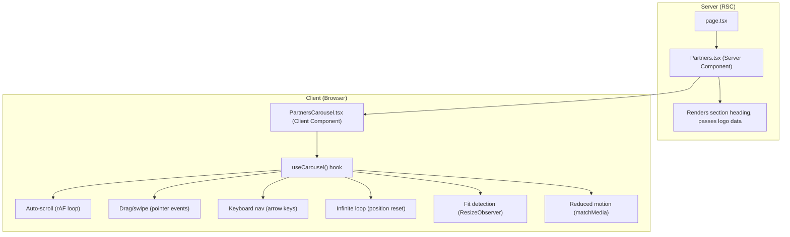

# Design Document — Partner Carousel

## Overview

<!--
  This design converts the Trusted Partners section from a static flex row
  into an infinite-scrolling horizontal carousel. It covers component architecture,
  scrolling mechanics, progressive enhancement, accessibility, and performance.
-->

This design converts the Trusted Partners section from a static flex row of 7 logos into an infinite-scrolling horizontal carousel. The carousel uses `transform: translateX()` for GPU-accelerated scrolling, `requestAnimationFrame` for smooth auto-scroll, and pointer events for unified drag/swipe handling across desktop and touch devices.

The implementation follows a progressive enhancement strategy: the base HTML/CSS renders a natively scrollable row of logos (no-JS fallback), and a client-side hook enhances it with auto-scroll, infinite looping, drag/swipe, and keyboard navigation.

### Key Design Decisions

| Decision | Rationale |
|---|---|
| Single `useCarousel` hook | All carousel logic (auto-scroll, drag, keyboard, resize, loop reset) lives in one custom hook, keeping the component thin and testable |
| `transform: translateX()` over native scroll | GPU-composited transforms avoid layout thrashing; required for seamless infinite loop position resets (Req 7.2) |
| Pointer events over mouse+touch | Single event model covers desktop, touch, and hybrid devices like Surface Pro (Req 1.7) |
| Logo duplication in JS, not SSR | Server renders the original logos only; the hook clones them client-side to avoid doubling HTML payload and to keep the no-JS fallback clean (Req 5.1) |
| `ResizeObserver` for fit detection | Debounced resize evaluation determines carousel vs static mode without page reload (Req 8.6) |
| No third-party carousel library | Keeps bundle size minimal; the logic is straightforward enough to implement with rAF + pointer events (Req 7.1) |
| CSS `will-change: transform` on track | Hints the browser to promote the track to its own compositing layer for smooth animation |
| `prefers-reduced-motion` via CSS + JS | CSS disables transitions; JS disables auto-scroll and uses instant snapping for drag/keyboard (Req 6.3, 6.4) |

---

## Architecture

### Component Architecture

<!--
  The Partners section splits into a Server Component (heading + data) and a
  Client Component (carousel interactivity). The hook encapsulates all stateful
  carousel logic so the component stays declarative.
-->



### File Structure Changes

```
src/components/
├── Partners.tsx              # Server Component — renders heading + delegates to PartnersCarousel
├── Partners.module.css       # Updated — adds carousel track, overflow, scrollbar-hide styles
├── PartnersCarousel.tsx      # NEW — Client Component wrapping the logo track with ARIA + events
└── hooks/
    └── useCarousel.ts        # NEW — Custom hook encapsulating all carousel state and side effects
```

### Rendering Flow

<!--
  Progressive enhancement in four stages:
  1. Server HTML — static logos in a scrollable container
  2. Initial paint — natively scrollable (no-JS fallback works here)
  3. Hydration — hook measures, decides mode, optionally enhances
  4. Resize — dynamic re-evaluation without page reload
-->

1. **Server render**: `Partners.tsx` (Server Component) renders the section heading and passes `partnerLogos` data to `PartnersCarousel` (Client Component).
2. **Initial client paint**: `PartnersCarousel` renders logos in a flex row inside an `overflow-x: auto` container. Before JS hydration, this is a natively scrollable row with a visible scrollbar (no-JS fallback).
3. **Hydration + enhancement**: `useCarousel` hook runs:
   - Measures total logo width vs container width
   - If logos fit → stays in static centred mode (no carousel behaviour)
   - If logos overflow → duplicates logos for seamless looping, adds `.jsEnhanced` class (hides scrollbar), starts auto-scroll via rAF
4. **Resize**: `ResizeObserver` re-evaluates fit on every resize (debounced). Toggles between static and carousel mode dynamically.

---

## Components and Interfaces

### Partners.tsx (Server Component)

<!--
  Remains a Server Component. Only change: delegates the logo row to
  PartnersCarousel instead of rendering  elements directly.
  The section wrapper, heading, and subtitle are unchanged.
-->

```typescript
/**
 * Partners.tsx — Trusted Partners logo section.
 *
 * Server Component — renders the section wrapper, heading, and subtitle.
 * Delegates the logo row to PartnersCarousel (Client Component) which
 * handles carousel interactivity via progressive enhancement.
 *
 * @module Partners
 * @requirements 4.1, 4.2, 5.1
 */
import { partnerLogos } from '@/data/siteConfig';
import styles from './Partners.module.css';
import PartnersCarousel from './PartnersCarousel';

export default function Partners() {
  return (
    <section id="partners" className={styles.partners}>
      <div className="container">
        {/* Centred heading — uses shared .section-heading from globals.css */}
        <div className="section-heading">
          <h2>Trusted Partners</h2>
          <p>
            I work with leading financial institutions to deliver the best
            solutions for my clients.
          </p>
        </div>
        {/* Carousel component — handles static/scrolling mode dynamically */}
        <PartnersCarousel logos={partnerLogos} />
      </div>
    </section>
  );
}
```

### PartnersCarousel.tsx (Client Component)

<!--
  This is the new Client Component that wraps the logo track.
  It receives logo data as props and uses the useCarousel hook
  for all interactive behaviour.
-->

```typescript
/**
 * PartnersCarousel.tsx — Client Component for the partner logo carousel.
 *
 * Renders the carousel container with ARIA attributes for accessibility,
 * the logo track with translateX-based scrolling, and handles progressive
 * enhancement from native scroll to JS-powered carousel.
 *
 * @module PartnersCarousel
 * @requirements 1.1–1.7, 2.1–2.7, 3.1–3.4, 4.3–4.8, 5.1–5.3, 6.1–6.6, 7.1–7.5, 8.1–8.8
 */
'use client';

import type { PartnerLogo } from '@/lib/types';
import styles from './Partners.module.css';
import { useCarousel } from './hooks/useCarousel';

interface PartnersCarouselProps {
  /** Array of partner logo data — supports 1 to 32 entries (Req 8.1) */
  logos: PartnerLogo[];
}
```

Responsibilities:
- Renders the carousel container `<div>` with ARIA attributes (`role="region"`, `aria-roledescription="carousel"`, `aria-label="Trusted partner logos"`) when in scrolling mode (Req 6.1)
- Renders the logo track `<div>` that receives `transform: translateX(${offset}px)` from the hook
- Renders original logo `` elements with `loading="lazy"` and duplicated clones with `loading="eager"` (Req 7.3)
- Applies `tabIndex={0}` on the carousel container for keyboard focusability when in scrolling mode
- Applies `.jsEnhanced` class when the hook activates carousel mode (hides scrollbar, Req 4.6)
- Applies `cursor: grab` / `cursor: grabbing` based on drag state from the hook (Req 1.5, 1.6)
- When in static mode (all logos fit), renders logos in a centred flex row without duplication, ARIA carousel attributes, or keyboard handlers (Req 8.2–8.4)

### useCarousel Hook

<!--
  The core of the carousel logic. This hook manages all side effects:
  rAF animation loop, pointer event handling, keyboard events,
  ResizeObserver for fit detection, matchMedia for reduced motion,
  and visibilitychange for background tab pausing.
-->

```typescript
/**
 * useCarousel — Custom hook encapsulating all carousel state and side effects.
 *
 * Manages: auto-scroll (rAF), drag/swipe (pointer events), keyboard nav,
 * infinite loop (position reset), fit detection (ResizeObserver),
 * reduced motion (matchMedia), and visibility pausing.
 *
 * @param logoCount - Number of logos in the original set
 * @param options - Configuration for gap, logo width, and scroll speed
 * @returns Refs, state, and computed values for the carousel component
 */

interface UseCarouselOptions {
  /** Gap between logos in px — 48px desktop, 24px mobile (Req 4.4, 4.5) */
  gap: number;
  /** Width of each logo in px — fixed at 160px (Req 4.3) */
  logoWidth: number;
  /** Auto-scroll speed in px/s — approximately 15 (Req 2.1) */
  speed: number;
}

interface UseCarouselReturn {
  /** Ref to attach to the outer carousel container div */
  containerRef: React.RefObject<HTMLDivElement>;
  /** Ref to attach to the inner logo track div */
  trackRef: React.RefObject<HTMLDivElement>;
  /** Current translateX offset in px (negative = scrolled left) */
  offset: number;
  /** Whether the carousel is in scrolling mode (logos exceed container) */
  isScrolling: boolean;
  /** Whether a pointer drag is currently active */
  isDragging: boolean;
  /** Whether the logo set has been duplicated for infinite looping (false = static, true = one extra copy) */
  isDuplicated: boolean;
}
```

#### Internal State Machine

<!--
  The hook's behaviour depends on which combination of conditions is active.
  This table summarises which features are enabled in each state.
-->

| State | Auto-scroll | Drag | Keyboard | Loop reset |
|---|---|---|---|---|
| `static` | off | off | off | off |
| `scrolling` | on | on | on | on |
| `hovering` | paused | on | on | on |
| `dragging` | paused | active | off | on |
| `hidden` | paused | off | off | off |
| `reduced-motion` | off | on (instant snap) | on (instant snap) | on |

#### Auto-Scroll Logic

<!--
  The rAF loop advances the offset by speed * deltaTime each frame.
  deltaTime is capped to prevent large jumps after tab switches.
  The loop pauses/resumes based on hover, drag, visibility, and motion preference.
-->

- Uses `requestAnimationFrame` loop (Req 7.4)
- Advances `offset` by `speed * deltaTime` each frame (where `deltaTime` = time since last frame in seconds)
- `deltaTime` is capped at 100ms to prevent large jumps after tab switch or frame drops
- Pauses when: hovering, dragging, page hidden, reduced motion, or static mode
- Resumes from current position (no jump) when pause condition ends (Req 2.3, 2.5, 2.7)

#### Infinite Loop Logic

<!--
  Two copies of the logo set are rendered. When the scroll position reaches
  the boundary of one set, it resets to the equivalent position in the other
  set within the same animation frame — invisible to the user.
-->

- Logos are duplicated once (2 sets total) to fill the viewport and provide seamless wrap
- `oneSetWidth` = `logoCount * (logoWidth + gap)` — the pixel width of one complete set of logos
- When `offset <= -oneSetWidth`: reset `offset += oneSetWidth` (scrolling left, hit end → jump to start)
- When `offset > 0`: reset `offset -= oneSetWidth` (scrolling right/dragging right, hit start → jump to end)
- Reset happens within the same rAF frame — no visible jump (Req 3.4)

#### Drag/Swipe Logic

<!--
  Pointer events provide a unified API for mouse, touch, and pen input.
  setPointerCapture ensures move/up events are received even if the pointer
  leaves the carousel container during a drag.
-->

- Uses `onPointerDown`, `onPointerMove`, `onPointerUp` on the carousel container (Req 1.7)
- `onPointerDown`: records start X position, sets `isDragging = true`, calls `setPointerCapture` to capture pointer
- `onPointerMove`: if dragging, computes `deltaX = currentX - startX`, updates `offset` by `deltaX`, resets `startX` to `currentX`
- `onPointerUp`: sets `isDragging = false`, calls `releasePointerCapture`
- With reduced motion: drag still works but offset changes are applied instantly (no transition, Req 6.4)
- `preventDefault()` on pointer move during drag to prevent text selection and native scroll interference

#### Keyboard Navigation

<!--
  Arrow keys scroll by exactly one logo width + gap, matching the visual
  rhythm of the carousel. Tab does not trap focus — it moves to the next
  focusable element on the page.
-->

- Listens for `keydown` on the carousel container (which has `tabIndex={0}`)
- `ArrowRight`: decreases `offset` by `(logoWidth + gap)` — i.e., `offset -= (logoWidth + gap)` — scrolling content to the right (more negative offset) (Req 6.2)
- `ArrowLeft`: increases `offset` by `(logoWidth + gap)` — i.e., `offset += (logoWidth + gap)` — scrolling content to the left (more positive offset) (Req 6.2)
- With reduced motion: offset change is instant — no CSS transition applied (Req 6.4). This extends Req 6 AC 4 to include keyboard instant snapping under reduced motion; the requirement only explicitly mentions drag and swipe, but this design applies the same instant-snap behaviour to keyboard navigation for consistency across all manual interaction modes.
- Without reduced motion: a brief CSS transition (300ms ease) is applied for the keyboard step, then removed after transition ends
- Does not trap focus — `Tab` moves to next focusable element naturally (Req 6.6)
- Calls `event.preventDefault()` for ArrowLeft/ArrowRight to prevent page scroll

#### Fit Detection

<!--
  ResizeObserver watches the container width. When it changes, we recalculate
  whether all logos fit. This enables dynamic switching between static and
  carousel mode without a page reload (Req 8.6).
-->

- Uses `ResizeObserver` on the carousel container
- Computes `totalLogosWidth = logoCount * logoWidth + (logoCount - 1) * gap`
- Compares against `containerWidth` (observed width from ResizeObserver entry)
- If `totalLogosWidth <= containerWidth` → static mode (centred flex, no carousel, Req 8.2–8.4)
- If `totalLogosWidth > containerWidth` → scrolling mode (carousel active, Req 8.5)
- Debounced with a 150ms timeout to avoid excessive recalculation (Req 8.6)
- On mode change: resets offset to 0, adds/removes duplicated logos

#### Reduced Motion Detection

<!--
  Respects the user's OS-level motion preference. Both CSS and JS cooperate:
  CSS removes transitions, JS disables auto-scroll and uses instant snapping.
-->

- Uses `window.matchMedia('(prefers-reduced-motion: reduce)')` on mount
- Listens for `change` event to handle runtime preference changes
- When active: auto-scroll disabled, drag/keyboard use instant position changes (no transitions, Req 6.3, 6.4)
- CSS media query `@media (prefers-reduced-motion: reduce)` also disables `transition` on the track

#### Visibility Detection

<!--
  Pauses the rAF loop when the tab is hidden to conserve CPU and battery.
  Resumes from the current position when the tab becomes visible again.
-->

- Listens for `document.visibilitychange` event
- When `document.visibilityState === 'hidden'`: pauses rAF loop (Req 2.6)
- When visible again: resumes rAF loop from current offset (Req 2.7)

#### Gap Responsiveness

<!--
  The gap changes at the 768px breakpoint (48px → 24px). The hook must
  recalculate oneSetWidth whenever the gap changes to keep loop resets accurate.
-->

- The hook reads the current gap from the computed style of the track element on each ResizeObserver callback
- On resize, the gap may change (48px → 24px at ≤768px), which affects `oneSetWidth` calculation
- The hook recalculates `oneSetWidth` whenever the ResizeObserver fires
- **Breakpoint note:** When the viewport crosses the 768px breakpoint, the gap change (48px ↔ 24px) affects `totalLogosWidth` and may toggle the carousel between static and scrolling mode. The fit detection logic must recalculate using the new gap value on every resize callback to ensure correct mode determination at the breakpoint boundary.

---

## Data Models

### Existing Types (No Changes)

The `PartnerLogo` type in `src/lib/types.ts` remains unchanged:

```typescript
/** Partner logo displayed in the Partners section. */
export interface PartnerLogo {
  /** Partner company name — used as React key */
  name: string;
  /** Image path relative to /public, e.g. "/images/partners/logo.png" */
  src: string;
  /** Descriptive alt text for screen readers (Req 6.5) */
  alt: string;
}
```

### Existing Data (No Changes)

The `partnerLogos` array in `src/data/siteConfig.ts` remains unchanged. The carousel supports 1–32 logos dynamically (Req 8.1).

### CSS Module Classes (New/Modified)

<!--
  Summary of CSS class changes. The key addition is the progressive enhancement
  pattern: base styles provide native scroll, .jsEnhanced overrides for carousel.
-->

| Class | Purpose |
|---|---|
| `.carouselContainer` | Outer carousel wrapper — `overflow-x: auto` as no-JS fallback, `overflow: hidden` when `.jsEnhanced` |
| `.jsEnhanced` | Applied by hook when carousel is active — hides scrollbar, enables `overflow: hidden` (Req 4.6). Uses camelCase for CSS Modules compatibility; corresponds to the kebab-case `.js-enhanced` referenced in Req 4 AC 6 |
| `.logoTrack` | Inner track element with `display: flex`, `align-items: center`, `flex-wrap: nowrap` base for horizontal overflow; receives `translateX` transform |
| `.staticMode` | Applied by JS when all logos fit within the container — enables `flex-wrap: wrap` and `justify-content: center` for centred static layout |
| `.grabCursor` | `cursor: grab` — applied when carousel is idle and hoverable (Req 1.6) |
| `.grabbingCursor` | `cursor: grabbing` — applied during active drag (Req 1.5) |
| `.partnerLogo` | Updated: 160x70px, `object-fit: contain`, hover opacity 0.7 transition, no border-radius (Req 4.3, 4.8) |

### CSS Changes to Partners.module.css

```css
/**
 * Partners.module.css — Updated styles for carousel enhancement.
 *
 * Progressive enhancement pattern:
 * - Base: .carouselContainer has overflow-x: auto (native scroll fallback)
 * - Enhanced: .jsEnhanced hides scrollbar and uses translateX for scrolling
 */

/* --- Section wrapper (unchanged) --- */
.partners {
  padding: 80px 0;
  background: var(--white);
  border-top: 1px solid var(--gray-200);
}

/* --- Carousel container ---
 * No-JS fallback: overflow-x: auto provides native horizontal scroll
 * with a visible scrollbar (Req 5.1, 5.2).
 * min-height prevents CLS before images load (Req 7.5).
 */
.carouselContainer {
  overflow-x: auto;
  -webkit-overflow-scrolling: touch;
  min-height: 70px;
}

/* --- JS-enhanced state ---
 * Applied by useCarousel when carousel mode is active.
 * Hides scrollbar and switches to translateX-based scrolling (Req 4.6).
 */
.carouselContainer.jsEnhanced {
  overflow: hidden;
  scrollbar-width: none; /* Firefox */
}
.carouselContainer.jsEnhanced::-webkit-scrollbar {
  display: none; /* Chrome, Safari, Edge */
}

/* --- Logo track ---
 * Flex row of logos. Base uses nowrap so logos overflow horizontally,
 * enabling native overflow-x: auto scroll for the no-JS fallback (Req 5.1).
 * In static mode (.staticMode): wrap and centre when JS detects all logos fit.
 * In scrolling mode (.jsEnhanced): nowrap with will-change hint for GPU compositing.
 */
.logoTrack {
  display: flex;
  align-items: center;
  justify-content: center;
  gap: 48px;
  flex-wrap: nowrap; /* nowrap enables horizontal overflow for no-JS native scroll fallback */
}

/* Static mode: applied by JS when all logos fit within the container.
 * Wraps logos and centres them — no carousel behaviour needed. */
.staticMode .logoTrack {
  flex-wrap: wrap;
  justify-content: center;
}

/* When JS-enhanced and in scrolling mode, disable wrap for translateX */
.jsEnhanced .logoTrack {
  flex-wrap: nowrap;
  justify-content: flex-start;
  will-change: transform;
}

/* --- Cursor states for drag interaction (Req 1.5, 1.6) --- */
.grabCursor { cursor: grab; }
.grabbingCursor { cursor: grabbing; }

/* Individual partner logo: border-radius removed per prototype, hover opacity corrected to 0.7 */
.partnerLogo {
  width: 160px;
  height: 70px;
  object-fit: contain;
  transition: opacity var(--transition);
  flex-shrink: 0; /* Prevent logos from shrinking in flex row */
}
.partnerLogo:hover {
  opacity: 0.7; /* Matches Req 4 AC 8 and main spec Req 8 AC 5 */
}

/* --- Reduced motion: disable all scroll-related transitions (Req 6.3) --- */
@media (prefers-reduced-motion: reduce) {
  .logoTrack {
    transition: none !important;
  }
  .partnerLogo {
    transition: none !important;
  }
}

/* --- Mobile: reduce gap from 48px to 24px (Req 4.5) --- */
@media (max-width: 768px) {
  .logoTrack {
    gap: 24px;
  }
}
```

### Height Reservation (CLS Prevention)

<!--
  The carousel container sets min-height: 70px (matching logo height)
  to reserve vertical space before images load, preventing layout shift (Req 7.5).
-->

The `.carouselContainer` sets `min-height: 70px` matching the logo height to prevent cumulative layout shift before images load (Req 7.5).


---

## Correctness Properties

*A property is a characteristic or behavior that should hold true across all valid executions of a system — essentially, a formal statement about what the system should do. Properties serve as the bridge between human-readable specifications and machine-verifiable correctness guarantees.*

<!--
  Properties derived from prework analysis of 41 acceptance criteria across 8 requirements.
  After reflection, 14 distinct properties remain after eliminating redundancy.
  Each property is universally quantified and references the requirements it validates.
-->

### Property 1: Drag direction matches pointer delta

*For any* pointer drag interaction on the carousel (starting from any offset), if the pointer moves by deltaX pixels horizontally, the carousel offset should change by exactly deltaX pixels in the same direction.

**Validates: Requirements 1.2, 1.3**

### Property 2: Loop reset keeps offset within bounds

*For any* carousel offset and oneSetWidth (computed from logo count, logo width, and gap), if the offset crosses a set boundary (offset <= -oneSetWidth or offset > 0), the reset operation should bring the offset back within the range (-oneSetWidth, 0], and the visual position of logos should be identical before and after the reset.

**Validates: Requirements 3.2, 3.3**

### Property 3: Auto-scroll pauses and resumes from current position

*For any* pause condition (hover, drag, or page hidden), when the condition becomes active the auto-scroll offset should stop advancing, and when the condition ends the auto-scroll should resume from the exact offset it had when paused — not from zero or any other position.

**Validates: Requirements 2.2, 2.3, 2.4, 2.5, 2.6, 2.7**

### Property 4: Fit detection determines carousel mode

*For any* combination of logo count (1–32), logo width (160px), gap (24px or 48px), and container width, the carousel should be in scrolling mode if and only if `logoCount * logoWidth + (logoCount - 1) * gap > containerWidth`. When in static mode, auto-scroll, drag, infinite looping, and duplication should all be disabled.

**Validates: Requirements 8.2, 8.3, 8.5, 8.6, 8.7, 8.8**

### Property 5: Logo rendering completeness

*For any* partner logo in the data array, the rendered carousel should contain an `` element with `width="160"`, `height="70"`, a non-empty `alt` attribute matching the logo's alt text from the data, and `object-fit: contain` styling.

**Validates: Requirements 1.1, 4.3, 6.5**

### Property 6: Logo duplication in scrolling mode

*For any* carousel in scrolling mode with N original logos, the total number of rendered logo `` elements should be exactly 2 * N (one original set plus one duplicated set).

**Validates: Requirements 3.1**

### Property 7: Auto-scroll advancement rate

*For any* carousel in scrolling mode (not paused by hover, drag, hidden tab, or reduced motion), after elapsed time T seconds, the offset should have advanced by approximately `speed * T` pixels (within a tolerance of ±2px to account for frame timing).

**Validates: Requirements 2.1**

### Property 8: ARIA attributes present in scrolling mode

*For any* carousel in scrolling mode, the carousel container element should have `role="region"`, `aria-roledescription="carousel"`, and `aria-label="Trusted partner logos"`. In static mode, these carousel-specific ARIA attributes should not be present.

**Validates: Requirements 6.1**

### Property 9: Keyboard step size

*For any* carousel in scrolling mode with a given gap value, pressing ArrowRight should change the offset by exactly `-(logoWidth + gap)` pixels, and pressing ArrowLeft should change the offset by exactly `+(logoWidth + gap)` pixels.

**Validates: Requirements 6.2**

### Property 10: Reduced motion disables auto-scroll

*For any* carousel where `prefers-reduced-motion: reduce` is active, the auto-scroll should not advance the offset regardless of elapsed time, hover state, or visibility state.

**Validates: Requirements 6.3**

### Property 11: Reduced motion allows manual interaction with instant snap

*For any* carousel where `prefers-reduced-motion: reduce` is active, drag, swipe, and keyboard interactions should still change the offset, but no CSS transition should be applied to the track element during or after the interaction.

**Validates: Requirements 6.4**

### Property 12: Track transform reflects offset

*For any* offset value set by the carousel hook, the logo track element's inline `transform` style should be `translateX(${offset}px)`.

**Validates: Requirements 7.2**

### Property 13: Lazy/eager loading split

*For any* carousel in scrolling mode with N original logos, the first N `` elements (original set) should have `loading="lazy"`, and the next N `` elements (duplicated set) should have `loading="eager"`.

**Validates: Requirements 7.3**

### Property 14: Dynamic logo count support

*For any* logo count between 1 and 32 (inclusive), the carousel should render without errors, display all logos, and correctly determine whether to activate scrolling mode based on the fit detection logic.

**Validates: Requirements 8.1**

### Property 15: Auto-scroll activates on mode transition

*For any* carousel that transitions from static mode to scrolling mode (due to logo count or viewport resize), auto-scroll SHALL activate automatically without user interaction.

**Validates: Requirement 2.1**

### Property 16: Responsive gap breakpoint

*For any* viewport width above 768px, the gap between logos SHALL be 48px. *For any* viewport width at or below 768px, the gap SHALL be 24px.

**Validates: Requirements 4.4, 4.5**

---

## Error Handling

<!--
  The carousel is a presentational component with no network requests or user input.
  Error handling focuses on graceful degradation and edge cases in browser API support.
-->

| Scenario | Handling |
|---|---|
| **JavaScript disabled or fails to load** | Progressive enhancement: the no-JS fallback renders a natively scrollable row with a visible scrollbar (Req 5.1, 5.2). No carousel features, but all logos are visible and accessible. |
| **Zero logos provided** | `PartnersCarousel` renders nothing (empty container). The section heading still renders from the Server Component. |
| **Single logo provided** | Fit detection puts the carousel in static mode — one centred logo, no scrolling or duplication. |
| **Images fail to load** | The `` elements have explicit `width` and `height` attributes, so layout is preserved even if images fail. Broken image indicators appear but layout doesn't shift (Req 7.5). |
| **ResizeObserver not supported** | Fallback: measure container width once on mount. Carousel mode won't dynamically toggle on resize in very old browsers, but initial mode detection still works. |
| **requestAnimationFrame not available** | Extremely unlikely in any browser that supports React 19. If absent, auto-scroll simply doesn't start — drag and keyboard still work via event handlers. |
| **Pointer events not supported** | Fallback: the no-JS native scroll remains functional. Drag/swipe won't work but keyboard navigation and auto-scroll (if rAF is available) still function. |
| **matchMedia not supported** | Reduced motion detection fails gracefully — auto-scroll runs normally, which is the default behaviour. |
| **Very fast resize (debounce)** | ResizeObserver callback is debounced at 150ms to prevent excessive recalculation and mode toggling during window resize drag. |

---

## Testing Strategy

<!--
  Dual testing approach: unit tests for specific examples and edge cases,
  property-based tests for universal correctness properties.
  Uses fast-check (already in devDependencies) for property-based testing.
  
  Why both: Unit tests catch concrete bugs at specific values and verify
  integration points. Property tests verify general correctness across
  hundreds of random inputs, catching edge cases humans wouldn't think of.
-->

### Testing Framework

- **Test runner**: Vitest (already configured in `vitest.config.ts`)
- **DOM environment**: jsdom (configured in Vitest)
- **Component testing**: @testing-library/react (already in devDependencies)
- **Property-based testing**: fast-check v4 (already in devDependencies)
- **Assertions**: @testing-library/jest-dom matchers (already in `vitest.setup.ts`)

### Unit Tests

<!--
  Unit tests cover specific examples, edge cases, and integration points
  that don't need randomised input. These complement property tests by
  verifying concrete scenarios and DOM integration.
-->

| Test | What it verifies |
|---|---|
| Renders heading and subtitle | Section heading "Trusted Partners" and subtitle text are present (Req 4.2) |
| Renders all 7 logos in static mode | With default 7 logos and wide container, all logos render centred without duplication |
| Applies ARIA attributes in scrolling mode | `role="region"`, `aria-roledescription`, `aria-label` present when carousel is active (Req 6.1) |
| No ARIA carousel attributes in static mode | Carousel-specific ARIA attributes absent when logos fit |
| Cursor classes toggle on drag | `.grabCursor` present when idle, `.grabbingCursor` during drag (Req 1.5, 1.6) |
| Tab does not trap focus | Pressing Tab moves focus out of the carousel container (Req 6.6) |
| No-JS fallback has overflow-x: auto | Base CSS provides native scroll without JS enhancement (Req 5.1, 5.2) |
| jsEnhanced class hides scrollbar | When hook activates, `.jsEnhanced` is applied (Req 4.6) |
| Section retains visual identity | White background, 80px padding, grey border preserved; verifies carousel occupies full container width (Req 4.1, Req 4.7) |
| Min-height prevents CLS | Carousel container has min-height: 70px (Req 7.5) |
| Zero logos renders empty | No errors when partnerLogos is empty |
| Single logo renders static | One logo renders centred, no carousel features |

### Property-Based Tests

<!--
  Each property test uses fast-check with a minimum of 100 iterations.
  Each test is tagged with a comment referencing its design document property
  using the format: Feature: partner-carousel, Property N: title.
  
  Each correctness property is implemented by a SINGLE property-based test.
  The test must not be split across multiple it() blocks.
-->

| Property | Test approach | Generator |
|---|---|---|
| P1: Drag direction | Generate random start offsets and drag deltas, verify offset changes by delta | `fc.integer()` for offset, `fc.integer({min: -500, max: 500})` for delta |
| P2: Loop reset bounds | Generate random offsets outside bounds, verify reset brings within range | `fc.integer()` for offset, `fc.integer({min: 1, max: 32})` for logo count |
| P3: Pause/resume position | Generate random offsets, simulate pause, verify offset unchanged during pause | `fc.integer()` for offset, `fc.constantFrom('hover', 'drag', 'hidden')` for condition |
| P4: Fit detection | Generate random logo counts (1–32) and container widths, verify mode matches formula | `fc.integer({min: 1, max: 32})`, `fc.integer({min: 200, max: 2000})` |
| P5: Logo rendering | Generate random PartnerLogo arrays (1–32), verify all imgs have correct attributes | `fc.array(partnerLogoArb, {minLength: 1, maxLength: 32})` |
| P6: Duplication count | Generate logo counts in scrolling mode, verify 2*N img elements | `fc.integer({min: 1, max: 32})` |
| P7: Auto-scroll rate | Generate random elapsed times, verify offset advancement within tolerance | `fc.float({min: 0.016, max: 2.0})` for deltaTime |
| P8: ARIA attributes | Generate logo counts and container widths, verify ARIA presence matches scrolling mode | Same as P4 generators |
| P9: Keyboard step | Generate random gaps (24 or 48) and current offsets, verify step size | `fc.constantFrom(24, 48)` for gap, `fc.integer()` for offset |
| P10: Reduced motion + auto-scroll | Generate random elapsed times with reduced motion on, verify zero advancement | `fc.float()` for time |
| P11: Reduced motion + manual | Generate drag deltas with reduced motion on, verify offset changes and no transition | `fc.integer()` for delta |
| P12: Transform reflects offset | Generate random offsets, verify track style.transform | `fc.float({min: -5000, max: 5000})` for offset |
| P13: Lazy/eager split | Generate logo counts in scrolling mode, verify loading attribute split | `fc.integer({min: 1, max: 32})` |
| P14: Dynamic logo count | Generate logo counts 1-32, render carousel, verify no errors and correct logo count | `fc.integer({min: 1, max: 32})` |
| P15: Auto-scroll on mode transition | Simulate transition from static to scrolling mode via resize, verify auto-scroll activates without user interaction | `fc.integer({min: 1, max: 32})` for logo count, `fc.integer({min: 200, max: 2000})` for container width |
| P16: Responsive gap breakpoint | Generate viewport widths above and below 768px, verify gap is 48px or 24px respectively | `fc.integer({min: 320, max: 2000})` for viewport width |

### Test File Structure

```
src/components/__tests__/
├── Partners.unit.test.tsx              # Unit tests for Partners + PartnersCarousel rendering
├── PartnersCarousel.property.test.tsx  # Property-based tests for carousel component behaviour
└── useCarousel.property.test.ts        # Property-based tests for the hook logic (pure functions)
```

### Property Test Tagging

<!--
  Each property-based test must include a comment referencing the design property
  so that test failures can be traced back to the specific correctness requirement.
-->

```typescript
/**
 * Feature: partner-carousel, Property 1: Drag direction matches pointer delta
 *
 * For any pointer drag interaction, the carousel offset should change
 * by exactly the drag delta in the same direction.
 */
it.prop(
  [fc.integer(), fc.integer({ min: -500, max: 500 })],
  (startOffset, dragDelta) => {
    // Setup carousel at startOffset, simulate drag by dragDelta
    // Assert: newOffset === startOffset + dragDelta
  }
);
```

### Test Configuration

- Minimum 100 iterations per property test (fast-check default is 100, which meets this requirement)
- Tests run via `vitest run` (single execution, no watch mode)
- jsdom environment for DOM simulation
- `@` path alias resolved via Vitest config
